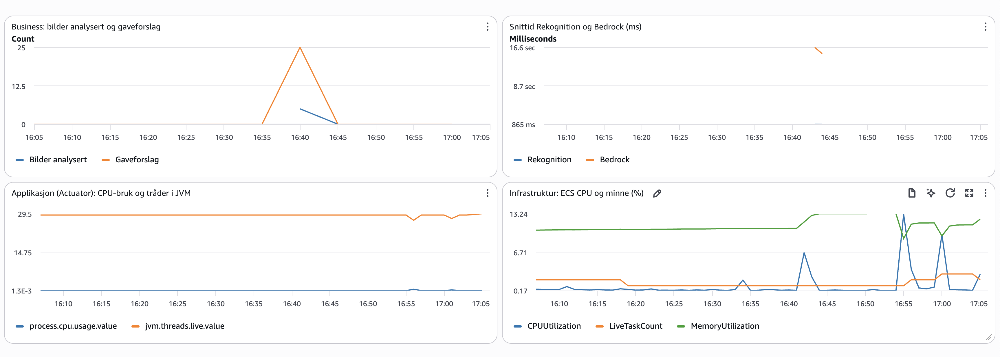

# README_SVAR – PGR301 Eksamen 2026

Kandidatnummer: 62

## Oppgave 1A

Dockerfilen er basert på den vi lagde i Docker-labben, og er en multi-stage build:

1. **Build-steg:** Et Maven-image med Java 21 bygger JAR-filen.
2. **Runtime-steg:** Et lite image med bare Java 21 runtime (JRE). Her kopieres kun JAR-filen inn.

Maven, JDK og kildekoden blir dermed igjen i build-steget. Det ferdige imaget blir mindre og inneholder bare det som trengs for å kjøre appen.

### Slik kjører du containeren

Bygg imaget fra rotmappen i repoet:

```bash
docker build -t marija .
```

Start containeren:

```bash
docker run -p 9999:8080 \
  -e AWS_ACCESS_KEY_ID=<aws-access-key> \
  -e AWS_SECRET_ACCESS_KEY=<aws-secret-key> \
  -e AWS_REGION=eu-west-1 \
  -e S3_BUCKET=minbucket-62 \
  marija
```

Appen kjører på port 8080 inne i containeren, og `-p 9999:8080` gjør den tilgjengelig på localhost:9999. AWS-nøklene sendes inn når containeren starter, så de aldri ligger i selve imaget.

Test at det fungerer:

```bash
curl -F "image=@samples/sample_image.png" http://localhost:9999/api/analyze
```

## Oppgave 1B

Workflow-filen ligger i `.github/workflows/docker.yml`, og bygger på workflowen fra Docker-labben.

Lenke til grønn kjøring: https://github.com/majadobri/PGR301eksamen/actions/runs/41659363324

Workflowen kjører bare ved push til `main`. Den bygger imaget og pusher det til ECR-repoet mitt, `marija`, som jeg opprettet med AWS CLI. AWS-nøklene ligger som GitHub Secrets.

### Tagging-strategi

Hvert image tagges med den korte commit-SHA-en, for eksempel `marija:efb348a`. Jeg valgte dette fordi:
- Hver commit får sin egen tag, så ingen bygg overskriver hverandre.
- Man ser nøyaktig hvilken kode som kjører, fordi taggen peker rett til en commit i GitHub.
- Det er enkelt å rulle tilbake til en tidligere versjon.
- Terraform kan deploye en bestemt versjon i oppgave 2. Med bare `latest` vet man ikke hva som faktisk kjører.

## Oppgave 2A

All Terraform-kode ligger i `infra/`. Jeg har delt den i flere filer etter tema:

- `providers.tf` – AWS-provider
- `backend.tf` – remote state (se 2B)
- `variables.tf` – region, kandidatnummer og image-tag
- `s3.tf` – S3-bucket for bildene (`minbucket-62`)
- `iam.tf` – task role for appen
- `ecs.tf` – ECS Express-tjenesten
- `outputs.tf` – URL til tjenesten, bucket-navn og task role

Tjenesten kjører imaget fra ECR-repoet `marija` med taggen som sendes inn i `image_tag`. Som execution role og infrastructure role bruker jeg de ferdige rollene i klassekontoen.

Appen må selv kunne kalle AWS-tjenester, så jeg har laget en egen task role (`wishifai-task-role-62`). Den har bare tilgangene appen trenger:

- `s3:PutObject` og `s3:GetObject` på min egen bucket
- `rekognition:DetectLabels` for å finne objekter i bildet
- `bedrock:InvokeModel` og `bedrock:Converse` for å lage gaveforslag

`S3_BUCKET` settes automatisk til navnet på bucketen Terraform lager, så den aldri må skrives inn for hånd.

Offentlig URL: https://wi-37b53dabe0e6491aa7aa5525a818722d.ecs.eu-west-1.on.aws

## Oppgave 2B

Terraform-state lagres i den delte bucketen `pgr301-terraform-state` med nøkkelen:

```
wishifai/62/terraform.tfstate
```

Kandidatnummeret i nøkkelen gjør at staten min ikke kolliderer med andre studenter.

Jeg har også slått på låsing av staten (`use_lockfile = true`), slik som i remote state-labben. Det betyr at bare én person kan endre infrastrukturen om gangen, så ingen overskriver hverandres endringer. I tillegg er state-filen kryptert (`encrypt = true`).

## Oppgave 2C

Jeg har lagt til en Terraform-jobb i samme workflow-fil som i 1B, `.github/workflows/docker.yml`.

Lenke til grønn kjøring: https://github.com/majadobri/PGR301eksamen/actions/runs/41665935413

Terraform-jobben har `needs: push_to_registry`, så den venter til imaget er bygget og pushet til ECR. Byggejobben sender commit-SHA-en videre, og Terraform deployer akkurat det imaget. Jobben kjører `terraform fmt -check`, `terraform init` og `terraform apply` i `infra/`, og feiler hvis koden ikke er riktig formatert.

Terraform må kjøre etter bygget, fordi det er det nye imaget som skal deployes. Kjørte Terraform først eller samtidig, kunne den prøvd å deploye et image som ikke finnes i ECR ennå. Og feiler bygget, kjører ikke Terraform i det hele tatt, så en ødelagt versjon blir aldri deployet.

## Oppgave 3A

Jeg har lagt til metrikker med Micrometer i `WishlistService`, fordi det er der hele flyten skjer: S3, Rekognition og Bedrock. Metrikkene sendes til CloudWatch under namespace `marija`, som jeg satte i `MetricsConfig`.

Jeg valgte disse metrikkene:
- `rekognition_latency` (Timer) måler hvor lang tid Rekognition-kallet tar.
- `bedrock_latency` (Timer) måler hvor lang tid Bedrock-kallet tar.
- `images_analyzed` (Counter) teller hvor mange bilder som er analysert.
- `gift_suggestions_per_analysis` (DistributionSummary) måler hvor mange gaveforslag Bedrock gir per bilde.

Rekognition og Bedrock måles hver for seg, så man ser hvilket av kallene som gjør tjenesten treg. Det er akkurat det grunderen lurer på.
De to siste er business-metrikker. `images_analyzed` viser hvor mye tjenesten faktisk brukes, som er noe investorer bryr seg om. `gift_suggestions_per_analysis` viser om Bedrock leverer det den skal.
Jeg la også `cloudwatch:PutMetricData` til i task-rollen, sånn at appen får lov til å sende metrikkene.

## Oppgave 3B

Dashboardet og alarmen ligger i `infra/cloudwatch.tf`. Dashboardet heter `marija`.



Dashboardet har fire widgets:
- Business: antall bilder analysert og antall gaveforslag. Viser hvor mye tjenesten blir brukt.
- Snittid Rekognition og Bedrock: hvor lang tid hvert kall tar i snitt.
- Applikasjon (Actuator): CPU-bruk og antall tråder i JVM.
- Infrastruktur (ECS): CPU, minne og antall tasks for tjenesten.

Dashboardet viser at Rekognition bruker under ett sekund, mens Bedrock bruker rundt 16 sekunder. Det er altså Bedrock som gjør tjenesten treg.

### Alarm

Alarmen `marija-bedrock-latency` går hvis Bedrock i snitt bruker mer enn 20 sekunder, to perioder på 5 minutter på rad.

Jeg valgte Bedrock fordi det er den tregeste delen av tjenesten, og den vi har minst kontroll over. Normalt tar den rundt 16 sekunder, så grensen ligger litt over det. Da går den hvis Bedrock blir merkbart tregere. To perioder på rad gjør at alarmen ikke går av ett enkelt tregt kall.

## Oppgave 4
Når man bruker generativ AI i en løsning som Wishifai, er det viktig å tenke på mer enn bare den tekniske funksjonen. Selv om tjenesten fungerer kan AI-en fortsatt komme med forslag som ikke passer eller er utrygge. Derfor er det viktig å ha gode rutiner for testing, leveranse og overvåkning. På denne måten sikrer man at AI-en gir gode og passende svar.

Vanlige tester sjekker ofte om samme input gir forventet output. Dette er vanskeligere med språkmodeller fordi samme bilde kan gi forskjellige gaveforslag hver gang.

I Wishifai kan man bruke et fast sett med testbilder og kontrollere at svarene følger bestemte regler. Man kan f.eks. sjekke at svaret har riktig format, at det inneholder faktiske gaveforslag og at forslagene ikke står på en liste over farlige produkter. Man kan også bruke en annen språkmodell til å vurdere om svarene er passende (LLM-as-judge). Slike tester bør kjøres i pipelinen før deploy, på samme måten som terraform fmt -check stopper pipelinen min i dag.

I Wishifai bestemmes modellen av miljøvariabelen BEDROCK_MODEL_ID. Det betyr at man kan bytte modell eller prompt uten å endre koden. Problemet er at slike endirnger da kan skje uten at de vanlige testene kjøres. 

Derfor bør modeller og prompter behandles som kode. De bør lagres i Git, versjoneres og kunne rulles tilbake hvis noe går galt. Dette fungerer på samme måte som image-taggene mine med commit-SHA. En ny modell kan også rulles ut gradvis med feature toggles eller først til en liten gruppe brukere gjennom canary deployment.

Dashboardet mitt viser responstid og hvor mange gaveforslag som lages, men alarmen varsler bare hvis Bedrock blir treig. Den oppdager ikke nødvendigvis om forslagene blir upassende. Derfor bør man også overvåke kostnader, tokenbruk, hvor ofte modellen nekter å svare, svarlengde og tilbakemelding fra brukerne. Et fall i gift_suggestions_per_analysis kan være et tegn på at noe er galt.

For å se om svarene er gode, må de lagres. Det kan være et personvernproblem, siden Wishifai bruker bilder fra folks hjem. Derfor må man være forsiktig med hvilke data som lagres.

Hvor strenge kontrollene bør være avhenger av konsekvensene av feil. I Wishifai er dårlig gaveforslag irriterende, men som regel ufarlig. Automatiske tester, stikkprøver og tilbakemeldinger fra brukere kan være nok.

I bank og helse kan feil få alvorlige konsekvenser. Da bør mennesker godkjenne endringer i modell og prompt, testene bør stoppe all deploy hvis de feiler og svarene bør kontrolleres av en fagperson før kunden får dem.

DevOps handler fortsatt om automatisering, små endringer og rask tilbakemelding. Med generativ AI må man også teste og overvåke hva modellen svarer, ikke bare at tjenesten fungerer. Jo større risiko feil kan føre til, desto mer testing og menneskelig kontroll trenger man. 